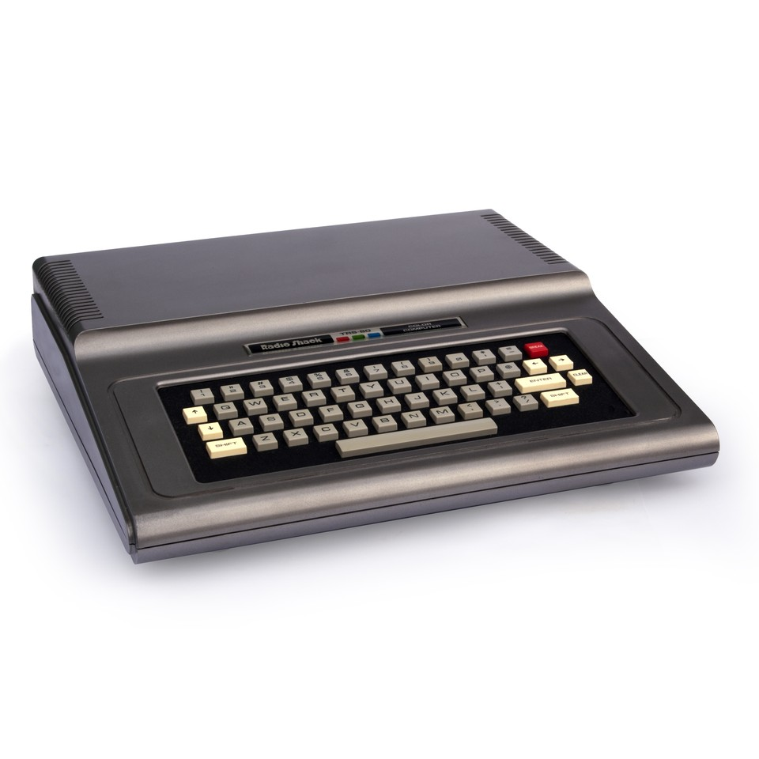
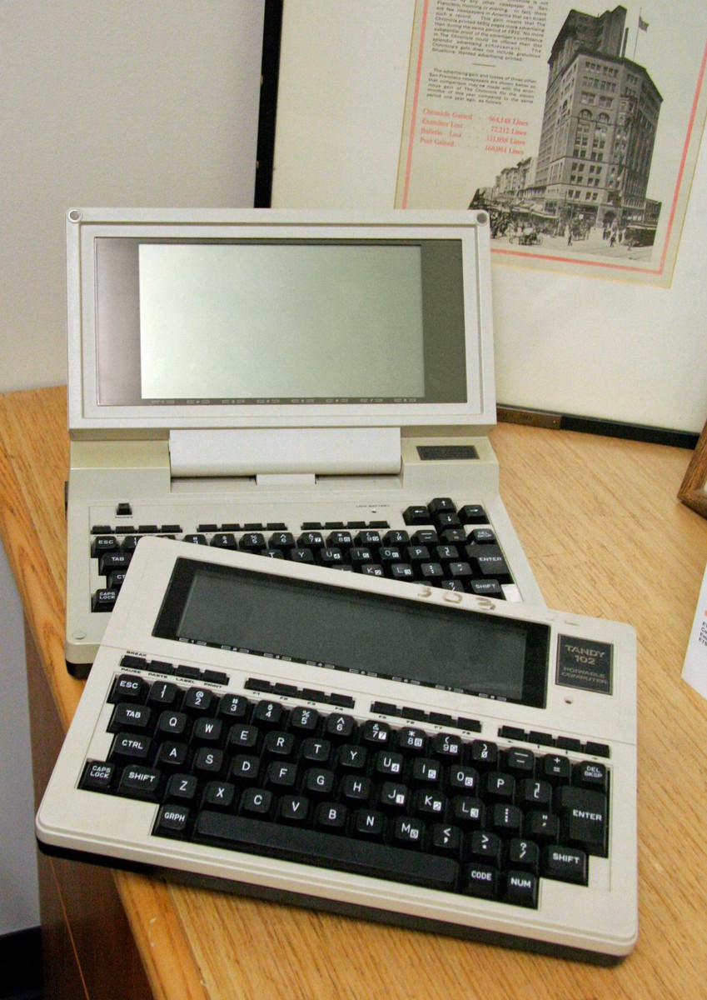
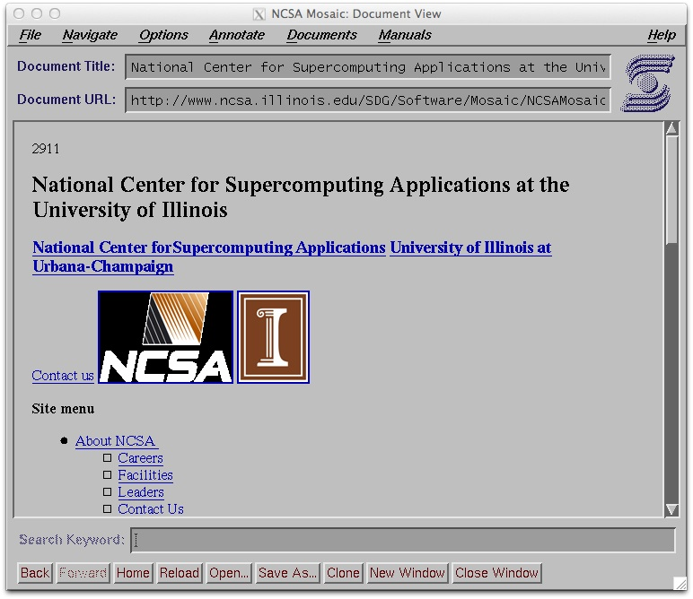
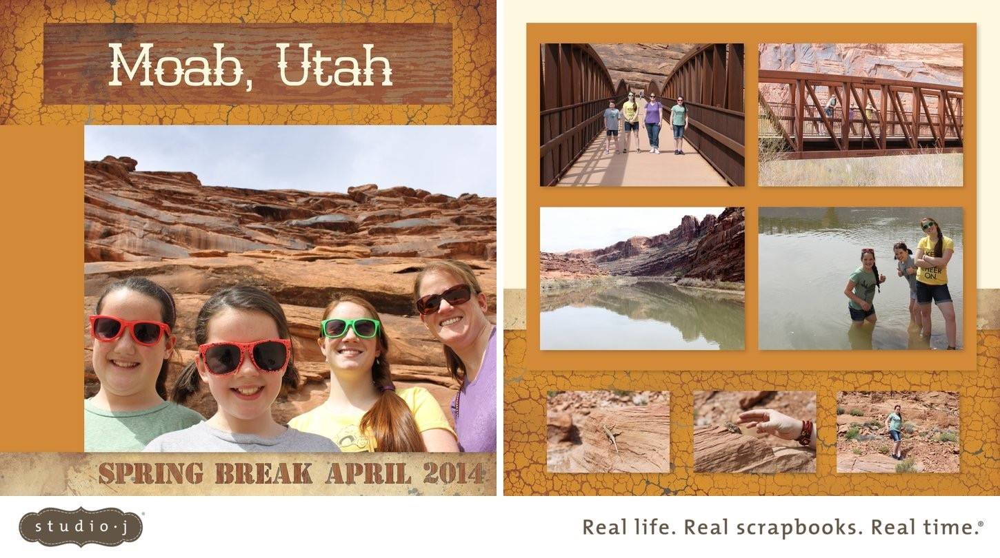

# AI Is Not a Bubble

*By Brian Holman, Founder & CEO, Dezota*

**I know what it costs to turn an idea into working software.**

I have raised venture capital, built companies, designed platforms, hired engineers, and lived through the long, expensive distance between knowing what a product should do and getting it to do it. I have spent more than thirty years moving between the keyboard, the architecture diagram, and the executive office. I have been a programmer, a web architect, a chief technology officer, a chief product officer, a chief operating officer, a president, and a CEO.

So when I say that what I am experiencing with AI is unlike anything I have experienced before, I have a basis for comparison.

In less than a month, working with AI agents, I have made progress that feels equivalent to what would once have taken me a year with a team of roughly fifty people.

Read that again.

That is my assessment of my own work, not a controlled experiment or a claim that every person will see the same result. But I know the work. I know the decisions, the dependencies, the engineering effort, and the meetings that used to stand between an idea and its implementation.

> **“I am watching that distance collapse.”**

When I describe the change as a [hundredfold increase in productivity](Career%20Vignettes/15-a-year-of-work-in-less-than-a-month.md), I am trying to communicate the scale of what it feels like to sit in that chair. A little faster does not come close. A better autocomplete does not come close.

**This is a different way to build.**

I read the articles warning that AI is overhyped, that the bubble is about to burst, that too much money is being spent, and that we could be heading toward economic disaster. Some raise serious questions. But when those warnings become a verdict on the technology itself, they miss what is happening in front of me.

**AI is not a bubble.**

I believe it is the most consequential expansion of human productive capability I have encountered in my lifetime.

In the summer of 1982, when I was eleven, I spent $500 earned selling a cow at the stock show on [my first computer](Career%20Vignettes/01-my-first-computer-and-the-stock-show-cow.md). My mom thought I was wasting my money. I started programming and thought: this is the future. I did not want to be a farmer like my dad. I wanted to do this. I sold my first software application at fourteen.

*A stock-show cow became a computer—and a different future. Photo: [Bilby, CC BY 3.0](Assets/README.md#trs-80-color-computer); resized and compressed.*

As a BYU freshman in autumn 1988, I took [a world history class](Career%20Vignettes/02-byu-undergraduate-the-only-laptop-in-history-class.md) with no textbook. The professor lectured, and everyone else tried to keep up on yellow legal pads. I had a Tandy Model 102 portable computer that I had bought in high school. I was typing a hundred words a minute. Classmates asked for copies of my notes.

I could see a use for that machine long before bringing a laptop to class became ordinary.

*Everyone else had a yellow legal pad. I had a Tandy—and a hundred words a minute. Model 102 in front, Model 200 behind. Photo: [mk97007, CC BY 2.0](Assets/README.md#tandy-model-102-and-model-200); resized and compressed.*

Later, as a [programmer in BYU’s Harold B. Lee Library](Professional%20Background/01-brigham-young-university.md), I was working with Gopher when I downloaded [Mosaic](Career%20Vignettes/03-seeing-the-web-through-mosaic.md) onto my DEC Alpha workstation. Seeing the graphical web for the first time was one of those moments you remember. This web thing was going to be awesome.

In January 1994, I created the library’s first website and put special collections online. I later co-authored [*Instant JavaScript*](https://www.dezota.com/about/leadership/brian-holman/instant-javascript/) as the web was becoming a place to build applications.

*The graphical web made the possibilities visible. Representative Mosaic screenshot; [source and license notices](Assets/README.md#ncsa-mosaic).*

At [Novell](Professional%20Background/02-novell.md), I spent four years trying to bring a networking giant into the web age. We built online commerce, worked to make NetWare more web-aware, and developed an award-winning intranet. I wanted the web embedded in what the company did.

From my perspective, the organization was too attached to its past. Seeing the opportunity was easier than getting everyone to move toward it.

Then I was recruited to [WebMiles](Professional%20Background/03-webmiles.md), my first executive job and first venture-funded startup experience. We raised $40 million to build a universal airline-miles loyalty program. Our Ralphs pilot with Kroger showed what we called the loyalty effect: customers would drive past a closer grocery store to earn rewards at another one.

I believed in the business. I also saw the excess. We spent millions on “[rent-a-relative](Career%20Vignettes/06-webmiles-a-real-idea-in-the-dot-com-bust.md)” advertising that I thought did little for the actual product. We lived through our share of dot-com foolishness.

After September 11, Kroger—our largest customer, accounting for about seventy percent of revenue—hesitated about promoting travel. I believed more funding could bridge the interruption. Our investors did not provide it, and we shut down.

I was one of the people inside a company that became dot-com roadkill. When somebody brings up Pets.com, I understand the warning. I also remember a useful idea caught between customer concentration, a terrible external shock, and investors unwilling to keep going.

At [Geolux](Professional%20Background/04-geolux-communications.md) and then [PointeCast](Professional%20Background/05-pointecast.md), we used the web to deliver training. At PointeCast, we raised millions of dollars in venture capital, developed a learning management system, acquired technology, and served more than a thousand customers around the world.

Later, when I returned to BYU for my [executive MBA](Career%20Vignettes/08-byu-executive-mba-the-first-iphone.md) after seven years as an executive, I bought the first iPhone. My classmates had BlackBerrys and thought I had paid an outrageous price. Why spend so much on this iPhone thing? My answer was: guys, trust me. The iPhone is the future.

At [Close To My Heart](Professional%20Background/06-ctmh.md), I was the lead architect of [Studio J](Career%20Vignettes/09-building-studio-j.md), our [patented](https://www.dezota.com/about/leadership/brian-holman/patents/) online photo collage and digital scrapbooking platform. We invested millions of dollars in research and development and brought in a private R&D shop to supplement our internal team. Even with that help, we were probably about a year behind schedule as we worked to get it out.

We had a grand vision, but execution was extraordinarily difficult. I know how much effort lived behind the apparently simple experience a customer saw on a screen.

*A grand vision. Millions in R&D. Still probably a year behind. This finished family scrapbook spread shows what Studio J made possible. [Image source](Assets/README.md#studio-j-moab-layout).*

Later, I worked on [global financial systems modernization](Professional%20Background/08-teksystems.md), [geospatial analytics](Professional%20Background/09-aeon-ai.md), and the transformation of a global company’s commerce platform. I became President of [Younique](Professional%20Background/10-younique.md). Today, I am back at [Dezota](Professional%20Background/11-dezota-wealthproof.md), building WealthProof to help people understand their investments and make more informed decisions.

The common thread is that I have repeatedly found myself working where something unfamiliar was becoming useful.

I have also spent a lifetime hearing some version of the same question: Why are you spending money on that?

I had been an early [Palm Pilot](Career%20Vignettes/05-from-palm-pilot-to-a-smartphone.md) user and adopted the Treo as those capabilities moved into a phone. In May 2013, I received a [Kickstarter Pebble smartwatch](Career%20Vignettes/10-pebble-and-building-moontiles.md). When I could not find a watchface I liked, I wrote Moontiles. A glance at my wrist helped me sort notifications without constantly reaching for my phone.

When Apple entered the smartwatch market, I adopted that too. I even had to read the instructions after unsuccessfully waving my wrist at a [Home Depot checkout](Career%20Vignettes/11-learning-the-first-apple-watch.md). Being early has never meant every feature was obvious or every experience was smooth. It meant I could see a reason to work through the rough edges.

I bought [Apple Vision Pro](Career%20Vignettes/12-apple-vision-pro-at-launch.md) at launch too. It is still a work in progress. It is still too heavy. But it is amazing, and I believe it points toward at least one aspect of the future. I can see the limitations of a device and still see why it matters.

That is how I recognize myself in the early adopter Geoffrey Moore describes in *Crossing the Chasm*. I am willing to work through the rough edges because I can see what the capability makes possible.

Today, laptops and smartphones are ordinary parts of everyday life, and smartwatches are familiar sights. We forget how strange new habits can look before they become normal.

With AI, I think we are still underestimating the change.

I had used [earlier AI coding tools](Career%20Vignettes/14-early-ai-tools-and-the-change-i-feel-now.md) in JetBrains. They helped, but sometimes I felt as though I was telling them the same thing twenty times before they got it right. I know the difference between a promising tool that is maddening to use and a partnership that changes the work.

My experience with ChatGPT-6 Astra feels like [conducting an orchestra](Career%20Vignettes/16-conducting-an-orchestra-of-exceptional-engineers.md).

*The experience matters. Now I can put more of it to work. [AI-generated editorial illustration](Assets/README.md#conducting-the-orchestra).*

I bring the vision, the business context, the architecture, and the judgment. I decide what we are trying to accomplish. I direct the work, question the results, and keep the pieces moving toward a coherent product. But now I can work with agents that help me think through problems and carry the work forward at a pace I could scarcely have imagined.

**The extraordinary part is the continuity.** I can move from strategy into architecture, from architecture into implementation, and from a problem into an attempted solution without putting each transition into somebody else’s queue.

I am still responsible for knowing whether the result makes sense. My experience matters. So does testing. But my ability to act on that experience has changed dramatically.

Over the years, I have worked with exceptional engineers who seemed twenty or fifty times more productive than their peers. Those people could change a project. They were also scarce, expensive, and sometimes difficult to fit into a team. Brilliant individual output did not always make the whole organization more effective.

Now imagine being able to direct an entire orchestra with that kind of capability available throughout it. That is the closest analogy I have for what I am experiencing. I can pursue an idea while it is still alive in my mind, instead of watching its energy drain away through handoffs, scheduling, and negotiation.

The investment that went into training these models has reached my desk as useful capacity. The intelligence, the responsiveness, and the quality of the partnership are changing what I can attempt.

That is why the skeptical coverage leaves me impatient, even when I understand the concern behind it.

[Jonathan Weil’s Wall Street Journal article](Articles/how-to-know-when-the-ai-boom-is-about-to-go-bust.md) asks what happens when companies that depend on outside financing can no longer obtain it. [CNBC’s account of Michael Burry’s warning](Articles/2026-09-28-cnbc-burry-ai-bubble.md) questions whether revenue can sustain the capital spending.

Those are real business questions. I have raised money and managed budgets. I understand that cash can run out while a product still has promise.

[Heather Stewart in the Guardian](Articles/2026-09-20-guardian-ai-bubble-collapse.md) worries about debt and future compute obligations spreading losses through interconnected companies. [Ingmar Rentzhog in Forbes](Articles/2026-09-28-forbes-ai-financial-crisis.md) describes how AI losses could combine with energy and climate shocks to create a credit crisis. [ABC News’s Australian report](Articles/2026-09-23-abc-data-centre-funding.md) raises questions about debt-funded data centers and inflation arriving before productivity gains. These arguments deserve attention on their own terms.

I cannot tell you that every data center will earn its cost back. I cannot tell you that every investor has paid the right price. I expect companies to fail, money to be wasted, and fortunes to reverse.

I was building web businesses around the dot-com collapse. Companies failed. The web continued to become essential. A bad investment could coexist with an extraordinary invention.

If an AI company fails, its failure will tell us something about its financing, execution, or market. It will not erase the productive capacity already available to people like me.

The critiques of usefulness are closer to the heart of my disagreement.

[Business Insider’s account of Steve Hanke’s skepticism](Articles/2026-02-21-business-insider-hanke-ai-warning.md) brings together doubts about language models and doubts about spectacular revenue forecasts.

I do not need a model to reach human-level intelligence in every dimension before it can transform my work. I need it to help me solve real problems. It is doing that now.

[Fortune’s report on Kara Swisher](Articles/2026-04-13-fortune-swisher-ai-overhyped.md) emphasizes resistance to artificial experiences and the desire for authentic human connection.

I share that desire. I am using AI to help build a useful product, with a purpose that comes from me. The human ambition is still at the center of the work.

[In Entrepreneur, Solo Ceesay argues that the revolution is mostly marketing](Articles/2026-04-27-entrepreneur-ai-marketing-hype.md), pointing to limited measured effects and weak demand.

I can accept that many organizations have yet to change how they work. My own experience shows me what becomes possible when someone with deep domain knowledge takes these tools seriously and reorganizes the work around them. I believe many others are going to discover that possibility.

And [Sanjot Malhi’s Fortune commentary](Articles/2026-08-21-fortune-ai-productivity-hype.md), despite its skeptical headline, makes a distinction I welcome: many AI productivity businesses may lack a durable advantage while AI itself has enormous potential.

I agree. A crowded field of weak products does not diminish the power available to someone who knows what to build.

My thirty years of experience have become more valuable to me because I can put more of them to work. Architecture, product judgment, leadership, and the ability to recognize a bad answer all matter. AI gives those capabilities a much wider reach.

That is the opportunity I wish more people would see.

Think about the person with a useful idea who could never afford the team. The specialist who understands a problem but has never had the resources to build a solution. The small business that has been living with an inadequate system because replacing it was beyond its budget.

> **“How many ideas have stayed trapped behind the cost of execution?”**

I believe we are beginning to lower that barrier on a scale we have barely imagined. More people will be able to try. More experiments will become possible. Some will fail. Some will become products, businesses, and ways of working that we do not yet have names for.

There will be disruption. People worried about their jobs deserve more than a cheerful promise. We will have to learn new skills, rethink organizations, and decide how to bring more people into this opportunity. But reducing the entire story to layoffs ignores the other side of the equation: the new capacity to create.

When I reach for an analogy as large as the Industrial Revolution, that is what I mean. The cost and speed of turning human intent into useful work are changing. In my corner of the world, I can already feel it.

I am not asking you to buy a particular stock. I am asking you to get involved. Bring a real problem. Learn to direct the tools. Put your experience into the conversation. Go far enough that you can see what happens when the technology meets work you understand.

Then decide whether this is mostly marketing.

I have spent my career recognizing possibilities before they looked obvious. I have also spent it doing the painful work required to turn those possibilities into products. For the first time, the capacity available to me is catching up with the breadth of what I can imagine.

That is why I am so passionate about this moment.

I am sitting in the conductor’s chair, and the orchestra has started to play.

**AI is not a bubble.**

We are at the beginning of something much bigger than we can yet see.

---

*This essay is my voice and my thoughts, accelerated and supported by AI. You can see the process I used with ChatGPT-6.1 Sol to develop it—including the source material, career stories, and prompts—in the [AI Is Not a Bubble repository on GitHub](https://github.com/bkholman/AI-Is-Not-A-Bubble-Essay).*

[Career vignettes](Career%20Vignettes/README.md) · [Professional background](Professional%20Background/README.md) · [Article index](Articles/README.md) · [Artwork credits](Assets/README.md) · [Prompt index](Prompts/README.md) · [Brian’s Dezota biography](https://www.dezota.com/about/leadership/brian-holman/)
