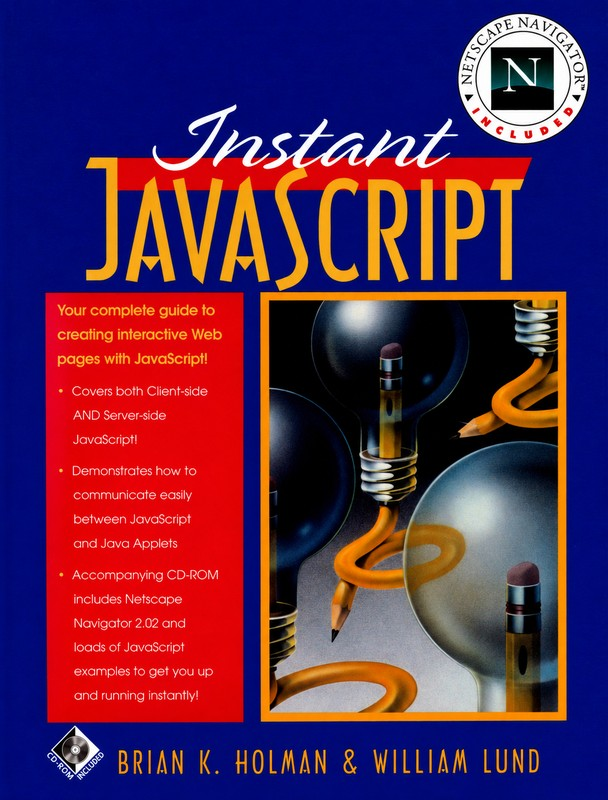

# Seeing the web through Mosaic

At [BYU](../Professional%20Background/01-brigham-young-university.md), I was a programmer in the Harold B. Lee Library, working with the text-based Gopher system. I remember downloading Mosaic onto my DEC Alpha workstation for the first time.

Suddenly I could see the graphical web. My reaction was immediate: this web thing is going to be awesome.

I was working alongside people in BYU’s computer science department, and I helped bring the university into that new world through the library’s website. I put special collections online. I could see how much bigger this could become.

My boss had come from Hewlett-Packard and had a connection with Prentice Hall. We proposed a book and ended up writing [*Instant JavaScript*](https://www.dezota.com/about/leadership/brian-holman/instant-javascript/). The web was becoming a place to build things, and I wanted to be deep in that work.

*Instant JavaScript, Prentice Hall, 1996. [Book and reflections](https://www.dezota.com/about/leadership/brian-holman/instant-javascript/) · [Cover source and restoration note](../Assets/README.md#instant-javascript-cover).*

---

[Vignette index](README.md) · [Essay](../README.md) · [Career entry](../Professional%20Background/01-brigham-young-university.md)
